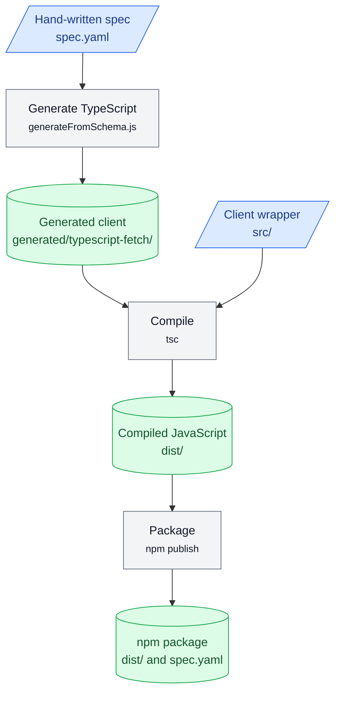

# arc-dataportal-api-client

OpenAPI client for the [ARC Data Portal API](https://dataportal.arc.gov.au/NCGP/Web/Grant/Help), which lists grants funded by the Australian Research Council. The ARC does not publish a spec for the API, so this package generates the client from a hand-written one, `spec.yaml`.

## Installation

```
npm install @eresearchqut/arc-dataportal-api-client
```

Releases are published to npm from `main`.

### Prereleases

Prereleases of other branches are published to GitHub Packages by the manual `publish-prerelease` workflow, under a `pre-<branch>` dist tag. To install one:

1. Create a GitHub personal access token (PAT) with the `read:packages` scope.
2. Add an `.npmrc` file to your project's root directory:
   ```
   @eresearchqut:registry=https://npm.pkg.github.com/
   ```
3. Log in to the registry, using your GitHub username and the PAT as the password:
   ```
   npm login --scope=@eresearchqut --registry=https://npm.pkg.github.com
   ```
4. Install the prerelease:
   ```
   npm install @eresearchqut/arc-dataportal-api-client@pre-<branch>
   ```

While that `.npmrc` is in place, every `@eresearchqut` package installs from GitHub Packages rather than npm.

## Usage

```ts
import { createArcDataPortalClient } from '@eresearchqut/arc-dataportal-api-client';

const { grants } = createArcDataPortalClient({
  headers: { 'User-Agent': 'my-app/1.0 (https://example.edu/my-app)' },
});

const { meta, data } = await grants.grantsGet({ filter: 'climate', sort: '-money', pageSize: 20 });
const { data: grant } = await grants.grantsIdGet({ id: 'DP190102138' });
```

`createArcDataPortalClient` returns the `grants` API, the underlying `configuration`, and a `health()` function. The API has no health endpoint, so `health()` requests a one grant page and rejects if that fails.

| Option | Description |
| --- | --- |
| `url` | Base URL. Defaults to `https://dataportal.arc.gov.au/NCGP/API`. |
| `headers` | Extra request headers, such as a `User-Agent` that names your application. |
| `fetchApi` | Replacement for the global `fetch`. |

`grantsGet` returns a page of grant summaries (`Grant`) and `grantsIdGet` returns one grant's details (`GrantDetail`), which add investigators, organisations, fields of research, socio-economic objectives and, for LIEF grants, the equipment register.

Every model is exported by its generated name (`Grant`) and also under an `ArcDataPortal` namespace (`ArcDataPortal.Grant`). The generated `Configuration` and `GrantsApi` are exported too, if you want to build the client yourself.

### Searching

`filter` takes the search language of the ARC Data Portal's web search, described on its [help page](https://dataportal.arc.gov.au/NCGP/Web/Grant/Help). Plain words search the grant text, and filter expressions narrow the results:

```ts
await grants.grantsGet({ filter: 'coral reef' });
await grants.grantsGet({ filter: '(scheme="Discovery Projects") AND(year-from="2020")' });
await grants.grantsGet({ filter: 'climate => (status="Active") AND(lief-register="true")' });
```

Filter expressions go in brackets joined by `AND(`, and `=>` separates search text from them. The expressions the web search uses are `scheme`, `year-from`, `year-to`, `funding-from`, `funding-to`, `admin-org-name`, `admin-org-short-name`, `state-name`, `state-short-name`, `four-digit-for`, `two-digit-for`, `status`, `fellowships-only` and `lief-register`. The response's `meta.search_description` holds the parsed expression tree, which shows how the API read the filter.

`sort` is one of `money` or `announced`, prefixed with `-` for descending order. Without it, grants come in the API's default order.

### Pagination

To read every grant of a search, pass a page function to `paginate`, which yields grants lazily. To get them all as an array, pass the result of `paginate` to `collect`. The page function receives a `pageNumber` and `pageSize` to put on the request:

```ts
import { collect, paginate } from '@eresearchqut/arc-dataportal-api-client';

const all = await collect(
  paginate((pageNumber, pageSize) => grants.grantsGet({ filter: '(admin-org-short-name="QUT")', pageNumber, pageSize })),
);

for await (const grant of paginate((pageNumber, pageSize) => grants.grantsGet({ filter: 'climate', pageNumber, pageSize }), { pageSize: 500 })) {
  // break to stop requesting pages
}
```

The helper starts at page 1 and stops after `meta.total_pages`, or on an empty page. `pageSize` defaults to 100. The API allows at most 1,000, and the helper rejects anything outside 1 to 1,000 with a `RangeError`, because the API silently clamps larger sizes and returns a nonsensical page count for 0.

### Errors

A request rejects with an `ArcDataPortalApiError` when the API answers with a non-2xx status or when the request never reaches the API. The error has `method`, `url` and `message`, and then either:

- `status` and `body` for a response. The body is the parsed JSON:API error document when the API sends JSON, and text otherwise. The first error's `detail` is appended to the message.
- `code` for a network failure, such as `ECONNREFUSED`.

An unknown grant id answers `400`, not `404`, with the detail `A Grant does not exist for id: <id>`. An invalid `sort` also answers `400`.

The generated `ResponseError` and `FetchError` are not thrown by this client. One gap remains: if a generated operation gets a successful response whose body is not valid JSON, or fails part way through, it rejects with the native `SyntaxError` or `TypeError`. This is because the generated runtime parses the body after the error middleware has run.

## Development

```
npm run build
npm test
```

Generation needs Java 21 or later, because it runs the `@openapitools/openapi-generator-cli` npm package. The generator version is pinned in `openapitools.json`. The tests need Docker.

### How the client is built



Blue shapes are inputs, grey boxes are steps, with the script that runs them, and green cylinders are files the build writes.

### The spec

`spec.yaml` is written from the API's responses, its help page and the web search, since the ARC publishes no spec. The generated `FromJSON` functions silently drop any field the spec does not name, so when the API adds a field, add it to `spec.yaml` too. Fields the API has been seen to send as `null` are marked `nullable`.

### Quirks of the API and the generated code

- The API reads `+` in a query string as its exact match operator, so a space in `filter` must be sent as `%20`. The generated client does this, but `URLSearchParams` sends `+` and changes the meaning of the filter.
- Grant ids can contain `/`, for example `AR04/00252`. `grantsIdGet` encodes it as `%2F`, which the API accepts.
- Hyphenated JSON keys become underscores on the models (`scheme_name`, `current_funding_amount`, `total_pages`), while the camelCase keys of grant details keep their case (`investigators_current[].familyName`).
- `links` in responses use `http://` even though the API is served over HTTPS.
- `anticipated_end_date` on a grant summary is a string, because the API sends an empty string when there is no date.

### Tests

Tests run against a WireMock container started by `jest-testcontainers`. Each test registers its own stubs with [wiremock-captain](https://github.com/wbd-open-source/wiremock-captain), and `test/setup.ts` fails any test that sends a request no stub matched.

`test/Contract.test.ts` checks the spec against reality. It deserialises responses recorded from the ARC Data Portal (`test/fixtures`), chosen to cover searches, LIEF grants, fellowships, early grants and null values, and asserts that every field survives a `FromJSON` and `ToJSON` round trip. Re-record the fixtures with `npm run record-fixtures` when the API changes its responses.
